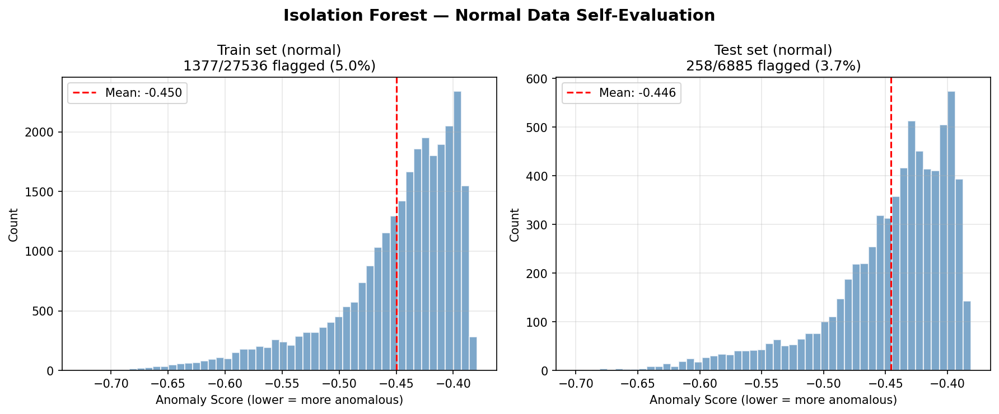
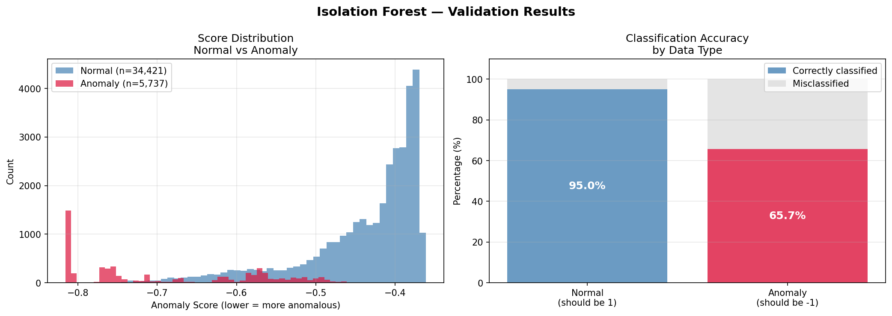

<div align="center">

  

  <p><strong>Runtime metric monitoring with a Python Isolation Forest prediction service and Java-based recommendations.</strong></p>

  <p>
  
  
  
  
  

  </p>

  <p>
  <a href="https://github.com/yajneshx94/aiops-anomaly-detection/stargazers"></a>
  <a href="https://github.com/yajneshx94/aiops-anomaly-detection/network/members"></a>
  <a href="https://github.com/yajneshx94/aiops-anomaly-detection/commits/main/"></a>
  </p>

  <a href="https://github.com/yajneshx94/aiops-anomaly-detection"><strong>View source repository →</strong></a>

</div>

<p align="center"></p>

---

A monitoring project that analyses application/runtime metrics, uses a Python machine-learning service to identify unusual metric patterns, and presents operational recommendations through a live dashboard.

> **Project scope:** The model detects unusual runtime-metric patterns. Java rules generate recommendations; the application does **not** automatically execute scaling, retries, or circuit-breaker actions. Dashboard stress/failure modes simulate metric patterns rather than performing production fault injection.

## 🧭 Contents

- [What it does](#what-it-does)
- [Architecture](#architecture)
- [Technology](#technology)
- [Main endpoints](#main-endpoints)
- [Model and features](#model-and-features)
- [Requirements and setup](#requirements-and-setup)
- [Training and validation](#training-and-validation)
- [Model visualizations](#model-visualizations)
- [Design notes and limitations](#design-notes-and-limitations)

<a id="what-it-does"></a>
## What it does
- Collects or simulates runtime metric values such as goroutines, open file descriptors, heap utilization, and request duration.
- Sends feature values from the dashboard through a Spring Boot API to a Python FastAPI prediction service.
- Uses a trained scikit-learn Isolation Forest model to return a normal/anomalous result and anomaly score.
- Applies separate Java rule-based logic to generate recommendations such as retry, scale, or circuit breaker.
- Displays metrics, anomaly results, recommendations, and recovery status on an HTML/CSS/JavaScript dashboard.
- Keeps a bounded, in-memory history of recent anomaly events in the Java application.

**Important scope note:** this project detects unusual runtime metric patterns; it is not primarily log anomaly detection. Recommendations are displayed for operators and are not automatically executed remediation actions. Dashboard stress/failure modes simulate metric changes; they do not constitute real fault injection against a production service.

<a id="architecture"></a>
## Architecture
```text
Podinfo metrics / dashboard simulation
                 ↓
          HTML + CSS + JS dashboard
                 ↓
          Spring Boot REST API
                 ↓ HTTP POST /predict
             Python FastAPI
                 ↓
       StandardScaler + Isolation Forest
                 ↓
      anomaly flag + score + confidence
                 ↓
        Java recommendation rules
                 ↓
       Dashboard result and history
```

<a id="technology"></a>
## Technology
### Java service

- Java 17
- Spring Boot 3.2.x
- Spring Web
- Spring Boot Actuator
- REST communication using `RestTemplate`
- In-memory anomaly history

### Python service

- Python
- FastAPI and Uvicorn
- scikit-learn
- pandas and NumPy
- joblib

### Dashboard and metrics source

- HTML, CSS, JavaScript
- Podinfo metrics exposed through a local proxy in the reviewed setup

<a id="main-endpoints"></a>
## Main endpoints
### Java service (default port 8080)

| Method | Endpoint | Purpose |
|---|---|---|
| `POST` | `/api/anomalies/analyze` | Submit features for analysis through the Python service |
| `GET` | `/api/anomalies/recent` | Retrieve recent anomaly events |
| `GET` | `/api/anomalies/history` | Retrieve event history |
| `GET` | `/api/anomalies/stats` | Retrieve summary statistics |
| `DELETE` | `/api/anomalies/clear` | Clear the in-memory history |
| `GET` | `/api/health` | Java-side health information |
| `GET` | `/api/health/ml-service` | Check ML service availability |
| `GET` | `/api/health/status` | Combined system status |

### Python service (default port 8000)

| Method | Endpoint | Purpose |
|---|---|---|
| `GET` | `/health` | Service health |
| `GET` | `/model/info` | Model information |
| `POST` | `/predict` | Predict for one feature set |
| `POST` | `/predict/batch` | Predict for a batch of feature sets |

<a id="model-and-features"></a>
## Model and features
The reviewed training script uses these five stable features:

- `go_goroutines`
- `process_open_fds`
- `heap_utilization_ratio`
- `avg_request_duration_sec`
- `http_request_duration_seconds_sum_rate`

The training script uses a `StandardScaler` followed by an `IsolationForest` model. The model identifies unusual observations; it does not assign a fixed named failure category such as “CPU failure” or “HTTP 503 anomaly.” The Java service applies separate rules to derive recommendations from the prediction and selected metric values.

<a id="requirements-and-setup"></a>
## Requirements and setup
- Java 17 and Maven
- Python and pip
- Python packages used by the service: FastAPI, Uvicorn, scikit-learn, pandas, NumPy, and joblib
- The trained artifacts expected by `ml_service.py`, typically `python-ml/models/isolation_forest.pkl` and `python-ml/models/scaler.pkl`
- A metrics source/proxy matching the URLs configured in `live_dashboardX4.html`

### 1. Start the Python prediction service

From `python-ml`, install the required Python packages and start the app using the entry point in the repository. If launching directly with Uvicorn, the module/app target must match the file's FastAPI app variable (for example, `uvicorn ml_service:app --host 0.0.0.0 --port 8000`).

Confirm the model and scaler artifacts exist before starting. The training and validation scripts also expect the corresponding processed datasets; inspect their paths before trying to retrain or validate the model.

### 2. Start the Java backend

From `java-services/monitoring-api`, run:

```bash
mvn spring-boot:run
```

The reviewed configuration points to the Python service at `http://localhost:8000` and uses five-second HTTP connect/read timeouts. Check `src/main/resources/application.properties` if your host or port differs.

### 3. Start the dashboard and metrics source

Open or serve `live_dashboardX4.html` in the supported local setup. The reviewed dashboard expects a metrics proxy at `http://localhost:3000/podinfo/metrics` and a Podinfo service reachable through that proxy. Start/configure those dependencies to match the URLs in the dashboard; the dashboard file alone does not start Podinfo or the proxy.

<a id="training-and-validation"></a>
## Training and validation
- `retrain_stable_model.py` trains a scaler and Isolation Forest from the configured normal training data and writes model artefacts/metadata.
- `validate_model.py` loads the trained artefacts and evaluates normal and anomaly test data. It does not retrain the model.
- Validation quality depends on the data files and label definitions used by the scripts.

Review the paths and confirm the expected datasets/model files are available in your checkout before running these scripts.

<a id="model-visualizations"></a>
## Model visualizations

The repository includes the figures produced by the model training and validation scripts. They are useful for reviewing the outputs alongside the data and scripts that generated them.

<table>
  <tr>
    <td align="center"><strong>Training results</strong></td>
    <td align="center"><strong>Validation results</strong></td>
  </tr>
  <tr>
    <td></td>
    <td></td>
  </tr>
</table>

<a id="design-notes-and-limitations"></a>
## Design notes and limitations
- Java anomaly history is held in memory and is lost when the service stops; no database is used for event storage.
- The model returns an anomaly result and score, while action recommendations are rule-based Java logic.
- The score is a model score, not automatically a calibrated probability that a failure will occur.
- Dashboard stress/failure modes are simulated metric patterns; they do not prove that a real service was crashed or automatically repaired.
- The model artifacts and processed datasets need to be present at the paths expected by the code.

---

<div align="center">

  

  <p><strong>Thanks for checking out this project!</strong></p>

  <p>
    
  </p>

</div>
